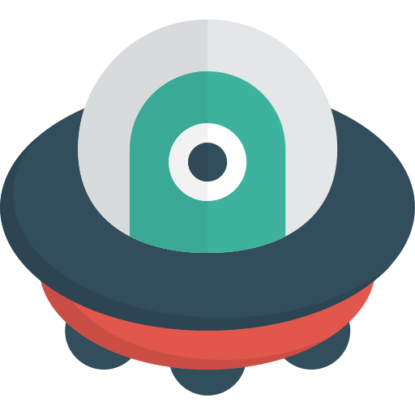

# Nebula Defender

<p align="center">
  
</p>

<h1 align="center">Nebula Defender</h1>

<p align="center">
  A polished, modern space shooter arcade game built with Python and Pygame
</p>

<p align="center">
  <a href="#features">Features</a> •
  <a href="#screenshots">Screenshots</a> •
  <a href="#installation">Installation</a> •
  <a href="#controls">Controls</a> •
  <a href="#roadmap">Roadmap</a>
</p>

---

## Overview

**Nebula Defender** is a modern take on the classic space shooter genre. Built from a basic tutorial project into a professional, portfolio-quality arcade game, it demonstrates clean architecture, engaging gameplay, and polished visuals.

### Key Features

- **Multiple Game Modes**: Easy, Medium, Hard, and Endless modes
- **Diverse Enemy Types**: Basic, Fast, Tank, Shooter, and Dodger enemies with unique behaviors
- **Epic Boss Battles**: Multi-phase boss fights with complex attack patterns
- **Power-Up System**: Rapid fire, double bullets, shield, health, speed boost, and laser weapons
- **Progressive Difficulty**: Waves get progressively harder with dynamic spawn rates
- **Particle Effects**: Explosions, hit effects, and engine trails
- **Screen Shake**: Dynamic camera shake on impacts
- **Modern UI**: Animated menus, smooth transitions, and polished HUD
- **Save System**: Persistent settings and high scores
- **Audio System**: Background music and dynamic sound effects

---

## Screenshots

<p align="center">
  
</p>

<p align="center">
  
  
</p>

<p align="center">
  
</p>

---

## Installation

### Prerequisites

- Python 3.8 or higher
- pip package manager

### Setup

1. **Clone the repository**
   ```bash
   git clone https://github.com/Rajat-Pandya/space-shooter-game.git
   cd space-shooter-game
   ```

2. **Install dependencies**
   ```bash
   pip install pygame
   ```

3. **Run the game**
   ```bash
   python main.py
   ```

### Development Setup

If you want to modify or extend the game:

```bash
# Create a virtual environment
python -m venv venv

# Activate it (Windows)
venv\Scripts\activate

# Activate it (macOS/Linux)
source venv/bin/activate

# Install dependencies
pip install -r requirements.txt
```

---

## Controls

### Movement
| Key | Action |
|-----|--------|
| `←` / `A` | Move left |
| `→` / `D` | Move right |
| `↑` / `W` | Move up |
| `↓` / `S` | Move down |

### Actions
| Key / Input | Action |
|-------------|--------|
| `Space` | Shoot |
| `Esc` | Pause / Back |
| `Left Mouse Click` / `Enter` | Select / Activate UI buttons |

---

## Settings Configuration

The game features in-game settings management persisted in `data/settings.json`:
- **Master Volume**: Global audio level slider (0% to 100%)
- **Music Volume**: Background music volume slider
- **SFX Volume**: Sound effects volume slider
- **Fullscreen**: Toggle between fullscreen and windowed display (applied immediately)
- **VSync**: Toggle vertical synchronization (applied immediately)

---

## Game Architecture

```
SpaceShooterGame/
├── main.py                 # Entry point and scene state loop
│
├── assets/                 # Tracked game assets
│   ├── images/            # Sprites and background graphics
│   ├── sounds/            # Laser and explosion SFX
│   └── music/             # Looping background music
│
├── entities/              # Game entities
│   ├── player.py         # Player ship with health/shields
│   ├── enemy.py          # Enemy archetypes and AI
│   ├── bullet.py         # Projectile system
│   ├── boss.py           # Multi-phase Boss enemy
│   └── powerup.py        # Power-up drops
│
├── scenes/                # Scene state machine
│   ├── menu.py           # Main menu scene
│   ├── gameplay.py       # Core gameplay scene
│   ├── pause.py          # Pause menu overlay
│   ├── gameover.py       # Game over score screen
│   ├── settings.py       # Settings menu
│   ├── controls.py       # Controls display
│   └── highscores.py     # High scores table
│
├── ui/                    # User interface
│   ├── buttons.py        # Animated and toggle buttons, sliders
│   ├── hud.py            # In-game HUD
│   └── menus.py          # Menu components
│
├── effects/               # Visual effects
│   ├── particles.py      # Particle burst system
│   └── screen_shake.py   # Directional screen shake
│
├── managers/              # Core managers
│   ├── settings_manager.py   # Settings persistence
│   ├── score_manager.py      # High scores persistence
│   └── audio_manager.py      # Centralized audio routing
│
├── utils/                 # Utilities
│   ├── constants.py     # Screen bounds, colors, enums
│   ├── helpers.py       # Math and collision helpers
│   └── asset_loader.py  # Cached asset loader with fallback
│
├── data/                  # Generated local save data (git-ignored)
│   ├── settings.json
│   └── highscores.json
│
└── .gitignore            # Git ignore rules
```

---

## Technical Highlights

### Clean OOP Architecture
- Modular design with clear separation of concerns
- Scene-based state machine pattern
- Entity-Component inspired structure

### Performance Optimized
- Capped at 60 FPS with vsync support
- Object pooling and capacity limits for particles and bullets
- Inset hitbox collision boundaries

### Dynamic Configuration
- Immediate display mode updates (fullscreen / vsync)
- Centralized audio routing through AudioManager
- JSON persistence for settings and high scores

---

## Roadmap & Known Limitations

### Completed
- [x] Core gameplay mechanics and player ship controls
- [x] Diverse enemy archetypes (Basic, Fast, Tank, Shooter, Dodger)
- [x] Multi-phase Boss encounters (5 progressive health phases)
- [x] Power-up system (Rapid fire, double bullets, shield, health, speed boost, laser)
- [x] Visual effects (directional screen shake and particle bursts)
- [x] Centralized audio system routed through AudioManager
- [x] Dynamic display mode switching (Fullscreen & VSync)
- [x] Persistent settings and top-10 high scores
- [x] Polished scene navigation and animated menus

### Known Limitations & Planned Specs
- [ ] **Save and Resume Session**: Mid-game progress save/load (`data/progress.json`) is not yet implemented.
- [ ] **Difficulty Selector UI**: Difficulty settings exist in engine constants (`DIFFICULTY_SETTINGS`), but no UI selector is provided in menus.
- [ ] **Laser Power-Up Scaling**: Laser projectile damage is currently fixed to default bullet damage (1).
- [ ] **Enemy-Escape Penalty**: Enemies flying past the screen bottom currently despawn without score or health penalty.
- [ ] **Unit Tests & CI**: Automated test suite (`pytest`) and GitHub Actions CI workflow are not yet configured.
- [ ] **Dead UI Components**: Menu helpers (`Menu`, `VerticalMenu`, `TabMenu`) and `FloatingTextManager` are preserved in codebase but unreferenced.

---

## Technologies Used

- **Python 3.8+**: Core language
- **Pygame 2.0+**: Game framework
- **JSON**: Save data format

---

## Credits

<!-- TODO: asset sources and tutorial credit -->

---

## License

This project is open source and available under the [MIT License](LICENSE).

---

## Contact

Created with passion for game development. Feel free to reach out with questions or suggestions!

<p align="center">
  <strong>Enjoy the game! 🚀</strong>
</p>
